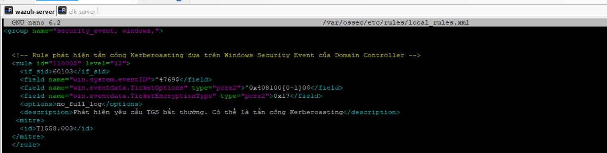
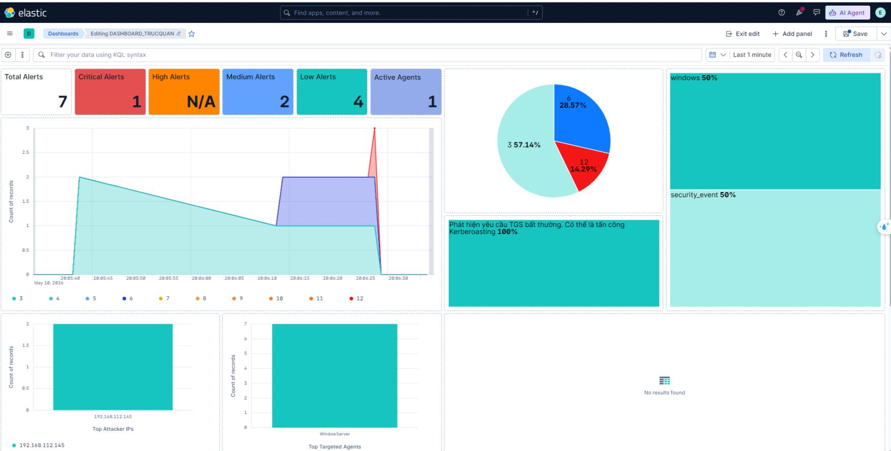
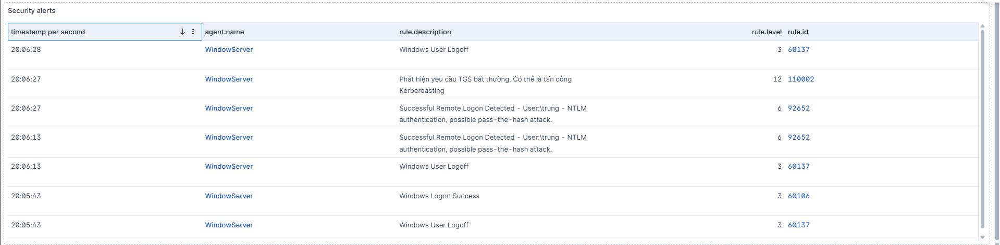

# Demo 01 — Kerberoasting detection

[← Project overview](../../README.md)

## Objective

Detect suspicious Kerberos service-ticket requests and retain the context needed to investigate the requesting host and service account.

## Recorded workflow

1. Prepare a domain environment with a service account and SPN.
2. Generate service-ticket activity from a lab domain account.
3. Collect Windows Security events from the domain controller through Wazuh.
4. Evaluate the custom detection rule.
5. Investigate the alert and associated fields in Kibana.

The report also records offline password recovery during the simulation. The evidence presented here focuses on the detection result and investigation trail.

## Detection logic

The rule screenshot shows rule **110002**, level **12**, parent rule **60103**, Windows Event ID **4769**, ticket encryption type **0x17**, and a ticket-options pattern. It also contains the mapping **T1558.003**.

The alert describes an abnormal TGS request that may indicate Kerberoasting. A matching event is an investigation signal; it is not evidence that offline cracking was itself observed by the SIEM.

## Dashboard

## Event investigation

| Field visible in the captured event | Recorded value |
|---|---|
| `data.win.system.eventID` | `4769` |
| `data.win.eventdata.ipAddress` | `::ffff:192.168.112.145` |
| `data.win.eventdata.serviceName` | `mssql_svc` |
| `data.win.eventdata.ticketEncryptionType` | `0x17` |
| `data.win.eventdata.ticketOptions` | `0x40810010` |

**Result:** the event list contains the suspicious-TGS alert, and the detailed event supplies the requesting IP and target service. No automatic blocking action is documented for this scenario.

## Interpretation and limits

The captured rule uses `TicketOptions` and `TicketEncryptionType`, while the Discover fields appear as `ticketOptions` and `ticketEncryptionType` with a `data.` prefix. The report does not include a raw rule-test transcript resolving this difference. Any future redeployment needs to validate the actual decoded field names and rule matching before relying on the screenshot as a configuration source.

**Source evidence:** report pages 42–45, Figures 36, 42, and 43.
