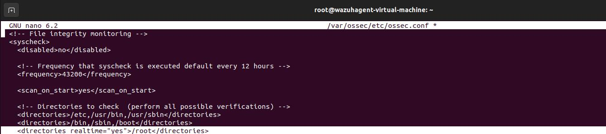
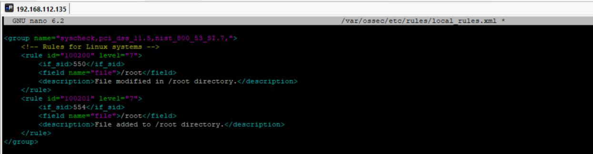
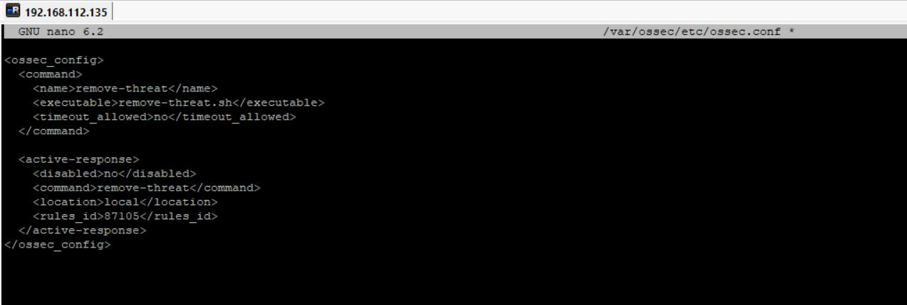
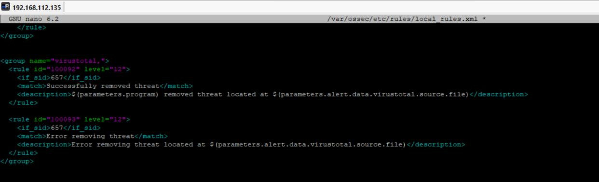
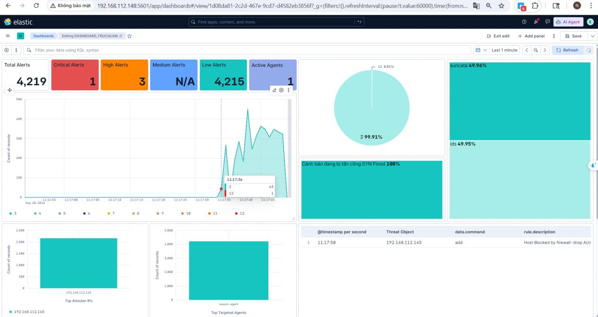
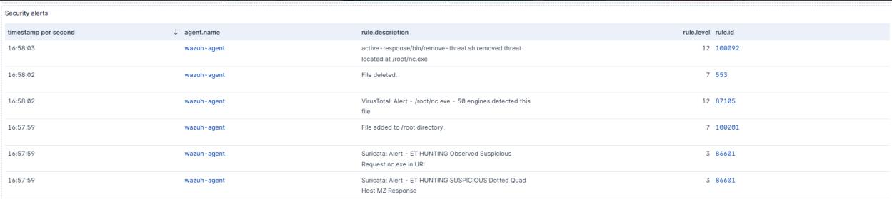
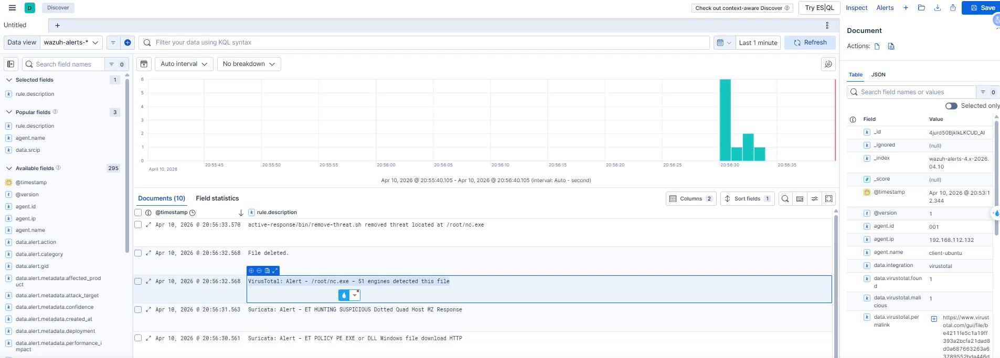
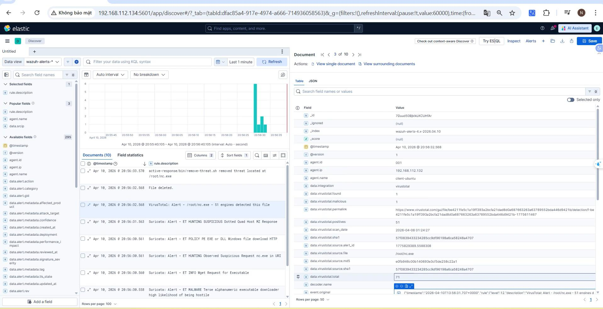
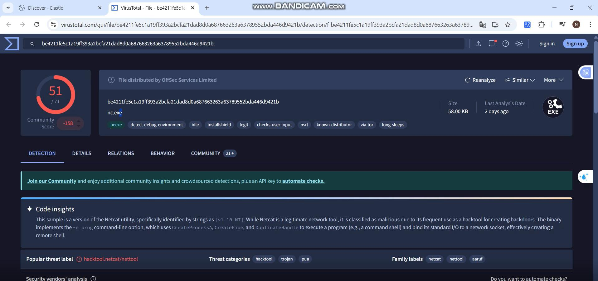

# Demo 02 — Malicious-file detection and removal

[← Project overview](../../README.md)

## Objective

Detect a flagged file through endpoint File Integrity Monitoring, enrich the event with VirusTotal, and verify the recorded automatic removal response.

## Recorded workflow

1. Configure FIM to monitor the target directory on the Ubuntu endpoint.
2. Place the demonstration file `nc.exe` in `/root`.
3. Generate a file-change event and query VirusTotal using its hash.
4. Trigger the configured `remove-threat.sh` Active Response for a malicious verdict.
5. Inspect the reputation result, response log, and deletion event in Kibana.

The file name identifies the report's sample; it does not imply that every file named `nc.exe` is malicious.

## Monitoring and response configuration

## Dashboard

## Detection and removal evidence

| Evidence | Captured value or message |
|---|---|
| Endpoint | `192.168.112.132` |
| File | `/root/nc.exe` |
| Integration | `virustotal` |
| `data.virustotal.found` | `1` |
| `data.virustotal.malicious` | `1` |
| `data.virustotal.positives` | `51` |
| `data.virustotal.total` | `71` |
| Response | `active-response/bin/remove-threat.sh removed threat located at /root/nc.exe` |
| Follow-up event | `File deleted.` |

The **51/71** result is the value stored in the selected integration event. A separate VirusTotal browser capture is preserved below; its presentation and lookup time should not be treated as a synchronized benchmark.

## Network context from Suricata

The captured event list also includes Suricata alerts associated with the executable download, including a Windows executable download over HTTP and a request referencing `nc.exe`. These events provide network context in the same Kibana view. The file-verdict and removal path is FIM → VirusTotal → Wazuh Active Response.

## Outcome

The recorded chain connects a file event to external reputation enrichment and then to a removal message plus a file-deleted event. This supports the demonstrated file-removal workflow. It does not establish that execution was prevented before detection, or measure protection against other malware samples.

**Source evidence:** report pages 45–49, Figures 44, 46, 48–49, and 52–55.
