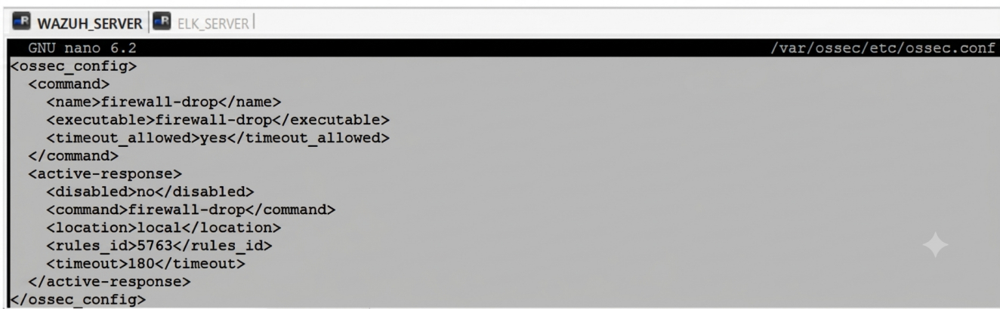
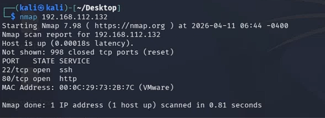
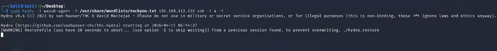
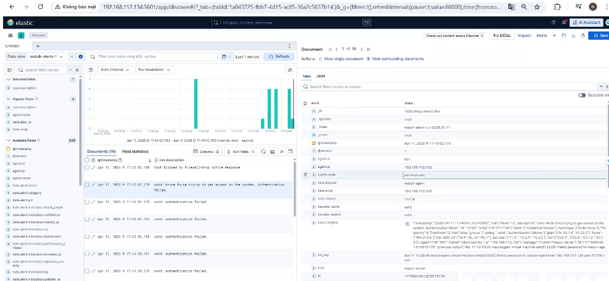
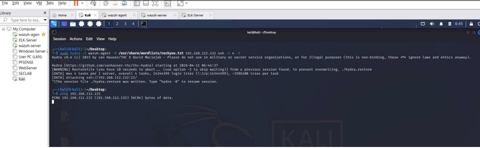

# Demo 03 — SSH brute-force detection and IP blocking

[← Project overview](../../README.md)

## Objective

Detect repeated SSH authentication failures on the monitored Ubuntu endpoint and verify automatic source-IP containment through Wazuh Active Response.

## Lab context

| Component | Recorded value |
|---|---|
| Target endpoint | `192.168.112.132` |
| Service | SSH, TCP port `22` |
| Simulated attack source | Kali Linux, `192.168.112.145` |
| Attempted account | `wazuh-agent` |
| Telemetry | Endpoint SSH authentication events collected by Wazuh |
| Response command | `firewall-drop` |
| Trigger rule | `5763` |
| Configured timeout | `180` seconds |

## 1. Configure Active Response

The supplied configuration enables `firewall-drop`, sets `timeout_allowed` to `yes`, and selects rule `5763`. Response location `local` targets the endpoint associated with the alert.

## 2. Verify the SSH service

The recorded Nmap scan shows TCP port **22 open** on `192.168.112.132`. Port 80 also appears in the scan, but SSH is the target of this scenario.

## 3. Generate repeated authentication attempts

The lab uses Hydra against the endpoint SSH service with the demonstration account. The following image records the start of the simulation; successful credential recovery is not claimed.

## 4. Inspect the monitoring dashboard

The dashboard presents alert severity, activity over time, source IPs, targeted agents, and a response table. The response table includes source **192.168.112.145**, command **add**, and **Host Blocked by firewall-drop Active Response**.

The displayed **118 total alerts** belong to the selected dashboard window and include other event categories. They are not 118 successful attacks or 118 unique brute-force detections.

## 5. Investigate the event sequence

The Discover event list shows:

- `sshd: authentication failed.`
- `sshd: brute force trying to get access to the system. Authentication failed.`
- `Host Blocked by firewall-drop Active Response`

The selected event supplies endpoint **192.168.112.132**, source **192.168.112.145**, and user **wazuh-agent**. The screenshot links the authentication activity to the response trail.

## 6. Verify containment on the endpoint

The firewall output shows an INPUT-chain **DROP** entry for **192.168.112.145**. This is the direct firewall-state evidence supporting containment.

The supplied document also records a ping attempt without visible replies after blocking. This screenshot is supporting context; it does not include a completed packet-loss summary.

## Result

The supplied evidence demonstrates SSH authentication-failure monitoring, a brute-force alert, an Active Response event, and a matching firewall DROP rule. The configured block timeout is **180 seconds**; timed unblock verification is not supplied.

## Evidence context

The dashboard capture displays a May 10 time window, while the scan and Discover captures show April 11. They document the same scenario across captures, not a single synchronized timing experiment. No response-latency figure is derived from them.

**Source:** `demossh.docx`, seven embedded images in document order. The full detection-rule definition and its attempt threshold are not supplied, so no specific attempts-per-window threshold is asserted.
