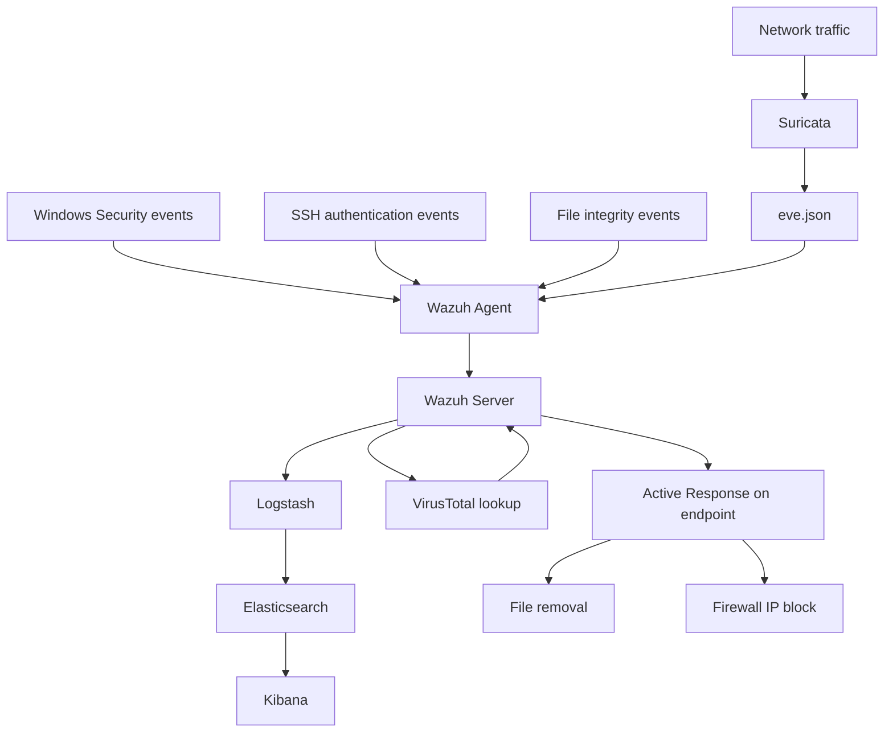

# Architecture — Wazuh, ELK Stack, and Suricata

[← Project overview](../README.md)

## Three complementary layers

| Layer | Technology | Implemented role |
|---|---|---|
| Network monitoring | Suricata | Inspects endpoint network traffic and produces EVE JSON alerts |
| Endpoint monitoring and analysis | Wazuh Agent + Server | Collects host and network events, decodes logs, applies detection rules, and orchestrates responses |
| Analytics and visualization | Logstash + Elasticsearch + Kibana | Forwards, indexes, searches, and visualizes Wazuh alerts |

Suricata runs on the monitored Ubuntu endpoint in the deployment described in section 2.2.2. Wazuh Agent collects its `eve.json` alongside host telemetry. [Integration evidence](suricata-integration.md) shows the capture interface, agent input configuration, and events in Kibana.

## Integration model

The lab uses **server integration**: Wazuh performs detection, then Logstash reads its alert output and forwards it to a separate Elastic search and visualization pipeline. Kibana displays the forwarded alerts. This is distinct from treating Kibana as the native Wazuh dashboard.

## Data and response paths

## Environment recorded in the report

| Item | Recorded information |
|---|---|
| Wazuh | Version 4.14 is stated in the installation section |
| Ubuntu | Ubuntu 22.04 is named in the deployment section |
| Lab network | `192.168.112.0/24` |
| Monitored Ubuntu endpoint | `192.168.112.132` in captured events |
| Kibana host | `192.168.112.134:5601` in screenshots |
| Simulated attack source | `192.168.112.145` in selected evidence |
| Endpoint interface | `ens33` in the Suricata integration section |
| Windows environment | Active Directory domain controller and domain accounts |
| SSH demo target | Ubuntu SSH service on TCP port 22 |

The report includes an Elastic **9.x package repository** command and a Wazuh integration template path labeled **4.x–8.x**. It does not establish a complete, version-pinned compatibility matrix. Exact Elasticsearch, Kibana, Logstash, Suricata, and Windows build numbers are therefore not asserted here.

## Log sources and artifacts

| Artifact | Role |
|---|---|
| SSH authentication events | Repeated failed login attempts for the SSH brute-force demo |
| Windows Security Event 4769 | Service-ticket request context for the Kerberoasting demo |
| `/var/log/suricata/eve.json` | Suricata JSON telemetry collected by the agent |
| Wazuh FIM events | File additions, changes, and deletions |
| `/var/ossec/logs/alerts/alerts.json` | Wazuh alert output consumed by the integration |
| `/var/ossec/etc/rules/local_rules.xml` | Custom Wazuh detection rules |
| `/etc/suricata/suricata.yaml` | Network scope, capture interface, and rule-loading configuration |
| `/var/ossec/etc/ossec.conf` | Agent/manager monitoring and response settings |
| `/var/ossec/active-response/bin/remove-threat.sh` | File-removal response referenced in evidence |
| `wazuh-alerts-*` | Kibana data view shown in the screenshots |

## Native Wazuh components and the ELK extension

The report describes Wazuh Server, Wazuh Indexer, and Wazuh Dashboard, and uses the Wazuh all-in-one quickstart. The separate ELK integration extends analysis through Logstash, Elasticsearch, and Kibana. Wazuh Indexer is not labeled as Elasticsearch, and Wazuh Dashboard is not labeled as Kibana in this project.

## Implementation coverage

The report documents agent onboarding, Logstash integration, a Kibana data view, dashboards, and Suricata log collection. This repository preserves the architecture and experiment evidence. Configuration screenshots are references to the recorded setup; they are not complete configuration exports or a ready-to-run installer.
