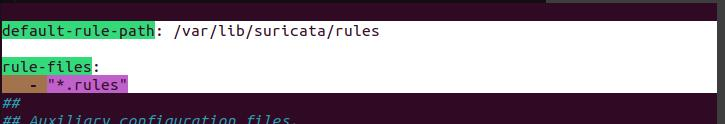
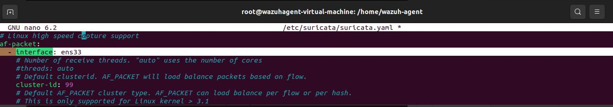
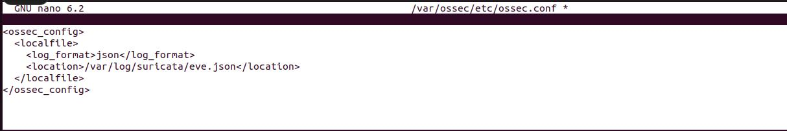
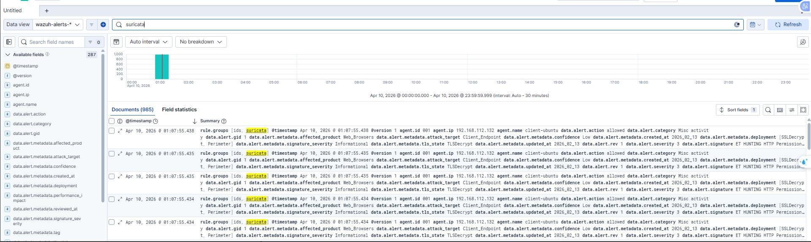

# Suricata integration — network IDS within the full stack

[← Project overview](../README.md)

## Deployment in the report

Chapter 2, section 2.2.2, installs **Suricata on the monitored Ubuntu endpoint**, alongside the Wazuh Agent. Traffic is inspected locally, alerts are emitted in EVE JSON, and Wazuh collects these events for centralized analysis. The report's theoretical discussion of pfSense is not the deployment topology demonstrated in this section.

| Component | Recorded setting |
|---|---|
| Network sensor | Suricata on the Ubuntu endpoint |
| Monitored network | `192.168.112.0/24` |
| Capture interface | `ens33` |
| Capture configuration | `af-packet` section in `suricata.yaml` |
| Rule directory | `/var/lib/suricata/rules` |
| Agent input | `/var/log/suricata/eve.json` |
| Input format | `json` |
| Central processing | Wazuh Server decoders and rules |
| Analytics destination | Elasticsearch and Kibana through Logstash |

## 1. Network capture and rules

## 2. Collect EVE JSON with the Wazuh Agent

The captured `localfile` configuration selects JSON input and the Suricata EVE log. This connects the network sensor to the same Wazuh analysis layer that receives endpoint security events.

## 3. Verify delivery to ELK

The recorded Discover view uses `wazuh-alerts-*` and displays Suricata events with `rule.groups` containing `ids` and `suricata`. Visible fields include alert action, category, signature, and endpoint context. This is evidence of network-alert ingestion through the integrated system, rather than only evidence that Suricata was installed.

## 4. Role in the selected demos

| Demo | Primary detection path | Suricata's role in the presented evidence | Response |
|---|---|---|---|
| Kerberoasting | Windows Security events → Wazuh rule | Additional network visibility; the Kerberoasting finding is grounded in Event 4769 | Alert investigation |
| Malicious file | FIM → VirusTotal enrichment → Wazuh | The event list includes network alerts around the executable download | Wazuh Active Response removes the flagged file |
| SSH brute force | SSH authentication events → Wazuh | System-wide network visibility; the supplied SSH evidence attributes detection to `sshd` events | Wazuh `firewall-drop` blocks the source IP |

The malicious-file event list includes Suricata entries for a Windows executable download and a request referencing `nc.exe`. These sit alongside VirusTotal and removal events in Kibana, showing the value of bringing network and endpoint evidence into one investigation view. This does not establish an additional cross-source correlation rule beyond those shown in the documents.

## Responsibility for blocking

The demonstrated containment actions are executed through **Wazuh Active Response**. The supplied integration evidence establishes Suricata's **network IDS** role; it does not establish an inline Suricata IPS deployment.

**Source:** report section 2.1, section 2.2.2, and the malicious-file demo; Figures 32–35 and 54.
